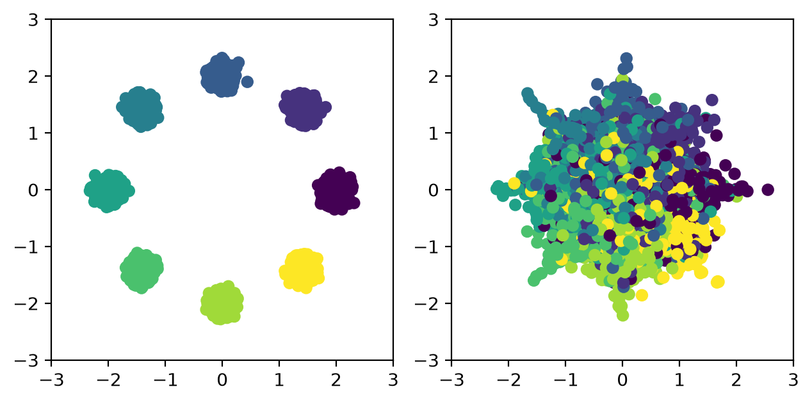
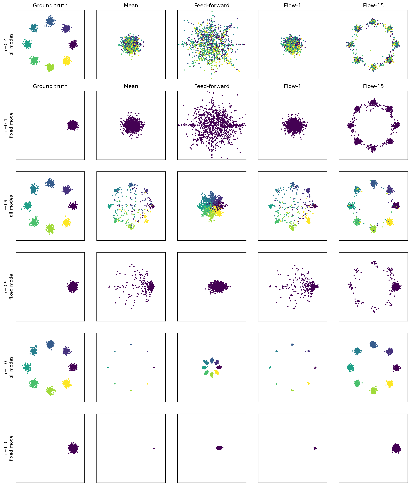

# From Feed-Forward to Flow

A small toy experiment comparing feed-forward prediction with conditional flow matching.

## Results

### Feed-forward comparison



### Flow matching Figure 1



## Run

```bash
python reproduced.py
```
